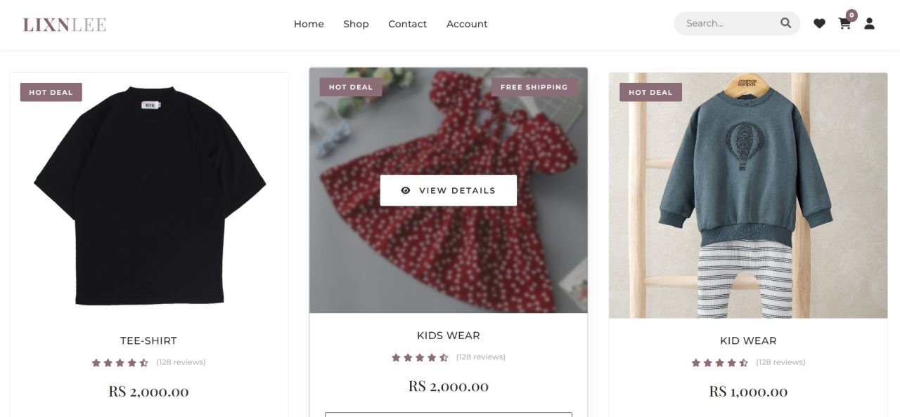
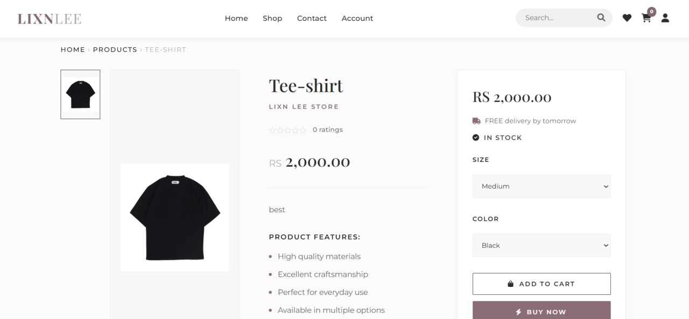

# LIXNLEE: PHP eCommerce System

A full-stack eCommerce web application built with PHP and MySQL. It covers the complete customer journey—from browsing products with smart filters to cart, checkout, payment simulation, and order tracking—paired with a complete administrative control panel.

## Preview


> **Note:** This project is provided as-is for learning, development, and demonstration purposes.

## Features

### 🛍️ Customer Experience

**Responsive Storefront:** Editorial design with a glassmorphic benefits bar and curated collections.
**Product Catalog:** 3-column product grid with multi-filter support (categories, sizes, and colors) and real-time search.
**Product Details:** Image gallery, variant selection, stock indicators, and customer reviews.
**Cart & Wishlist:** Real-time subtotal updates, quantity adjustments, and saved-for-later wishlist.
**Dynamic Checkout:** District-based delivery charges, category-based tax calculation, and promotional coupon engine.
**Payments & Invoicing:** Simulated card payment flow with instant printable/downloadable invoices.
**Customer Hub:** Account dashboard for tracking orders, managing saved addresses, submitting return requests (RMA), and messaging support.
**Support Chatbot:** Integrated virtual assistant for FAQs and shopping queries.

### ⚙️ Admin Management

**Dashboard & Analytics:** Executive overview of sales performance, revenue metrics, and order volume.
**Inventory & Catalog:** Full CRUD for products with multi-image support and low-stock alerts.
**Order Pipeline:** Complete lifecycle tracking (Pending, Processing, Completed, and Cancelled).
**Coupons & Promotions:** Campaign creator with percentage/fixed discounts and expiry rules.
**Returns & Support:** RMA request approval pipeline and customer contact message ticketing.
**User Management:** Customer and staff account administration.

---

## Screenshots

### Product Catalog



### Product Details



---

## Tech Stack

| Layer | Technology |
|---|---|
| **Backend** | PHP 7.4 / 8.x (MySQLi with Prepared Statements) |
| **Database** | MySQL / MariaDB |
| **Frontend** | HTML5, CSS3 (Custom Variables, Flexbox/Grid), JavaScript |
| **Typography & Icons** | Font Awesome 6, Google Fonts (Playfair Display, Montserrat) |
| **Server** | Apache (XAMPP recommended) |

---

## Getting Started

### Prerequisites

[XAMPP](https://www.apachefriends.org/) (Apache + MySQL with PHP 7.4+)

### Installation

1. **Prepare a sanitized checkout outside the document root.** Do not clone or copy a local workspace containing database exports, backups, real configuration, or private screenshots into Apache's `htdocs`:

   ```bash
   cd C:/xampp
   git clone <your-repo-url> "shopping cart"
   ```

   Before serving the application, deploy only reviewed runtime files under `htdocs`; keep database exports, backups, and private screenshots outside it. Keep real configuration outside the document root where the deployment supports it. If the application requires a configuration file in its tree, verify the Apache deny rule and filesystem permissions as additional protections.

   The ignore rules prevent these files from being newly added to Git, but do not remove files already tracked or protect files copied into a web root. Apache protections are an additional safeguard, not a substitute for keeping sensitive files out of the document root.

2. **Start Services:** Launch XAMPP Control Panel and start **Apache** and **MySQL**.

3. **Database setup:**
   - Do **not** import or publish `DB/shop_db (5).sql`; it is an original export retained locally for audit purposes.
   - `DB/shop_db_clean.sql` is not yet approved for publication or production use. Its sample data requires privacy review and an isolated `shop_db_test` import test before distribution.
   - Until that verification is complete, create a local development database from a separately reviewed schema/seed source. Do not point this application at a production database.
   - Never place database exports, backups, or real configuration files in a web-accessible location. If the project is served by Apache, keep those files outside the document root; do not rely on `.htaccess` as the only protection.

4. **Environment Configuration:**
   - Copy `config.sample.php` to `config.php`:

     ```bash
     cp config.sample.php config.php
     ```

   - Set `config.php` to use your isolated local development database and a dedicated MySQL account with a strong password. Keep this real configuration file and all credentials private; never publish them.

5. **Launch Application:**
   - **Storefront:** http://localhost/shopping%20cart/index.php
   - **Admin Login:** http://localhost/shopping%20cart/admin_login.php

---

## Project Structure

```text
shopping cart/
├── DB/                      # Local-only SQL exports; do not deploy or publish
├── screenshots/             # Project screenshots for README
│   ├── home.png
│   ├── products.jpg
│   ├── product-details.jpg
│   └── admin-dashboard.jpg
├── uploaded_img/             # Product catalog media uploads
├── css/ js/ images/          # Frontend stylesheets, scripts, and branding assets
├── index.php                 # Homepage & curated collections
├── products.php              # Product catalog with filters
├── product_details.php       # Product showcase & customer reviews
├── cart.php                  # Shopping cart
├── checkout.php              # Checkout, delivery & tax calculation
├── card_payment.php          # Card payment simulation
├── invoice.php               # Printable order invoice
├── track_order.php           # Customer order tracking
├── account.php               # Customer dashboard
├── userlogin.php             # Customer authentication
├── userreg.php               # Customer registration
├── admindash.php             # Admin command center
├── admin.php                 # Product & stock management
├── functions.php             # Core helper functions & database wrappers
├── config.example.php        # Safe public config template
├── config.sample.php         # Safe public config template alias
├── .env.example              # Environment variables template
└── config.php                # Local environment config (git-ignored)
```

---

## Administrator Setup

Create an administrator account locally from a command prompt using `php create_admin.php`. This script is CLI-only; do not expose it through a web server. Use a unique password and keep database credentials private.

> **Publication note:** `.gitignore` prevents new local files from being added but cannot remove files that were committed previously. Review repository history separately before any upload.

---

## License & Disclaimer

This project is provided as-is for **learning, development, and demonstration purposes**. Commercial use or public redistribution requires prior permission.

---

## Author

**LIVINGSAN**
